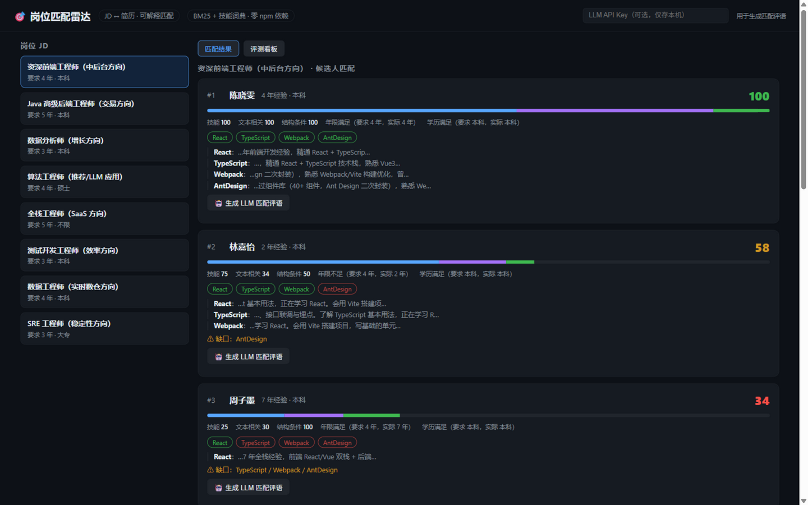
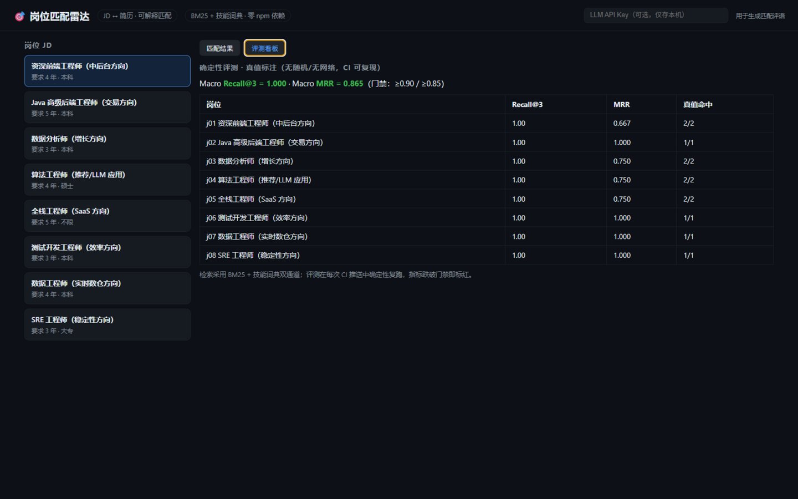

<div align="center">

# 🎯 岗位匹配雷达

**JD ↔ 简历双通道可解释匹配检索：BM25 + 技能词典，带确定性评测集与差距分析**

检索可解释 · 评测可复现 · 差距可行动 · 零 npm 依赖 · 单页可演示

[](https://nodejs.org)
[](package.json)
[](https://github.com/wjh941/jd-match-radar/actions/workflows/ci.yml)
[](LICENSE)




> 🎬 **使用场景**：HR 要在 200 份简历里为 8 个岗位挑人；求职者想知道自己的简历离目标岗位还差哪两行技能。匹配必须可解释——"为什么是他"要摆出简历原文证据，"差什么"要给出可行动的清单。
</div>

## 🎯 这个项目解决什么问题

招聘筛选的本质是**检索 + 判断**：从一堆简历里找出与岗位最匹配的人，并且说清楚"为什么是 TA、TA 还差什么"。通用大模型能做判断，但黑盒打分**不可解释、不可评测、每次结果还不一样**。

本项目的取舍：**检索层用确定性的 BM25 + 技能词典双通道**，每个匹配分数都能拆到"哪条证据命中、哪个技能缺口"；**评测层用真值标注的 Recall@3 / MRR**，在 CI 里确定性复跑——指标跌破门禁，代码就是红的。

## 🖼️ 界面预览

| 匹配结果 | 评测看板 |
| --- | --- |
|  |  |
| 每位候选人：总分 + 三维分解（技能/文本相关/结构条件）+ 命中技能 chips（绿=命中 红=缺口）+ **简历原文证据引用** + 差距清单 | Macro Recall@3 = **1.000**、MRR = **0.865**（门禁 ≥0.90 / ≥0.85），8 个岗位逐条列出，CI 确定性复跑 |

## 🔍 检索怎么做的（双通道）

| 通道 | 做法 | 解决什么 |
| --- | --- | --- |
| **技能通道**（权重 55%） | 类别化技能词典（前端/后端/数据与算法/通用，含别名归一：js→JavaScript、k8s→Docker 类聚），JD 抽出的**核心技能权重 3、加分技能权重 1**，按简历覆盖率打分，**每条命中附带简历原文证据** | 硬技能匹配必须精准可解释——"会 Vue"和"提过 Vue"不该同分 |
| **文本通道**（权重 35%） | Okapi BM25（k1=1.5, b=0.75）全分值归一。中文分词用零依赖方案：**技能词库最长匹配 + 兜底二元组**，不引 jieba 也有稳定区分度 | 捕捉技能词典覆盖不到的软性相关（"高并发""秒杀"这类经验词） |
| **结构通道**（权重 10%） | 年限/学历门槛，不满足即扣并给出理由 | 招聘的硬性门槛不该被文本相关度稀释 |

## 🧪 评测方法论（本项目与"调包侠 RAG"的区别）

- 10 份风格各异的候选人简历 + 8 个真实密度 JD，**人工标注 12 组真值对**
- 指标：**Recall@3 = 1.000**、**MRR = 0.865**（8 岗位 Macro 平均）
- 全链路**零随机数、零网络依赖**：同一份代码在任何机器上跑出的数字逐位一致，GitHub Actions 三个 Node 版本确定性复跑，跌破门禁即失败
- 评测驱动过两次真实修正：①加分技能公式在满分时越界（103 分 → 钳位 + 只补缺口两成）；②一组真值标注经"招聘视角"复核后修正——**评测集不仅是分数，更是纠错工具**

## 🚀 30 秒跑起来

```bash
npm run seed      # 1. 生成演示数据（10 简历 / 8 JD / 真值标注）
npm run server    # 2. 启动服务（http://127.0.0.1:4330）
npm test          # 3. 单元测试（14 个用例）
npm run eval      # 4. 确定性评测
```

**可选 LLM 评语**：界面右上角填 OpenAI 兼容 API Key（仅存本机浏览器，不落盘），每个匹配结果可生成一段招聘官视角的匹配评语——Key 只在你的浏览器里，转发时才带上。

## 🧱 工程亮点

| 实践 | 说明 | 效果 |
| --- | --- | --- |
| 零 npm 依赖 | 分词/BM25/技能抽取/HTTP 服务全部标准库实现 | clone 即跑，无供应链风险 |
| 可解释评分 | 每个总分可拆为技能/文本/结构三维，技能命中附简历原文证据 | 面试可讲、用户可信 |
| 确定性评测 | 真值标注 + Recall@3/MRR，CI 三版本 Node 复跑 | 检索质量回归有门禁 |
| 中文分词务实方案 | 词库最长匹配 + 二元组兜底 | 零依赖下检索质量可用（见评测） |
| 评分钳位 | 加分项只补核心缺口的两成，总分硬性 [0,100] | 评测驱动修复的真实 bug |
| Markdown 报告导出 | `GET /api/match/:id?format=md`，排名总览表 + 逐人证据/缺口归档格式 | 归档、直接粘贴给用人经理 |

## 📁 目录结构

```
├── server/
│   ├── seed.js            # 演示数据：10 简历 / 8 JD / 真值标注
│   └── store-server.js    # 零依赖 HTTP 服务 + 静态 UI + 可选 LLM 评语代理
├── lib/
│   ├── tokenize.js        # 中英混合分词（拉丁词 + 词库最长匹配 + 二元组兜底）
│   ├── skills.js          # 分类技能词典与别名归一
│   ├── bm25.js            # Okapi BM25 索引
│   └── scorer.js          # 可解释三维评分器 + 差距分析
├── evals/run-evals.js     # 确定性评测（Recall@3 / MRR）
├── public/index.html      # 单页 UI（匹配结果 / 评测看板）
└── tests/                 # 14 个 node:test 用例
```

## 🗺️ Roadmap

- [ ] 接入真实简历 PDF 解析（复用 ai-resume 的解析层）
- [ ] 向量检索通道（可选 embedding + 余弦重排，与 BM25 做 RRF 融合）
- [ ] 候选人视角反向检索："我的简历适合哪些岗位"
- [ ] 评测集扩充到 50 组真值对

## 📄 License

[MIT](LICENSE)
